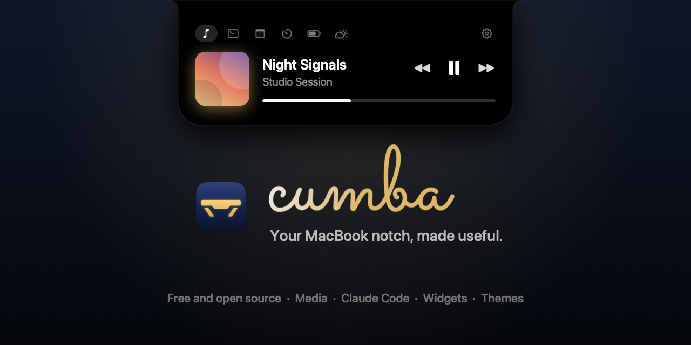
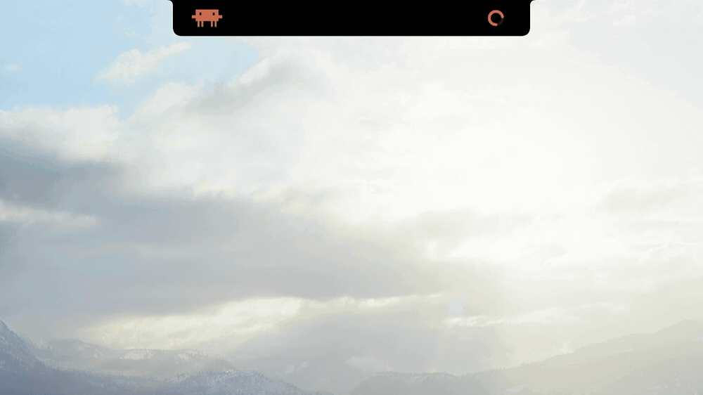

<p align="center"></p>

<h1 align="center">
  <picture>
    <source media="(prefers-color-scheme: dark)" srcset="docs/cumba-dark.svg">
    
  </picture>
</h1>

<p align="center"><sub>by LJASP · formerly cumbaNotch</sub></p>

<p align="center">
  <a href="https://github.com/LJASP-studio/Cumba/releases/latest"></a>
  <a href="https://github.com/LJASP-studio/Cumba/actions/workflows/build.yml"></a>
  
  <a href="LICENSE"></a>
</p>

<p align="center"><a href="https://cumbanotch.com">cumbanotch.com</a> · <a href="README.tr.md">Türkçe</a></p>

<p align="center"></p>

A free, open source notch app for macOS. Rest the pointer on the MacBook notch and a panel grows out of the camera housing, with whatever is playing, what Claude Code and Codex are doing, and the widgets you picked, in a look you make your own.

A *cumba* is the small bay window that juts out from the upper floor of old Turkish houses: a quiet place to sit and see what's happening in the street. The panel does the same from the top of your screen.

## What you get

- One mini player for whatever is playing in any app: Spotify, Music, YouTube in Safari or Chrome, podcasts. Artwork, seeking and controls, with no extension or setup.
- Claude Code and Codex in the notch. See what the agent is doing and how full its context window is, and answer its permission requests with Allow, Deny or In Terminal without switching windows.
- Widgets you arrange in tabs: a calendar with a Join button for calls, Apple Notes, Reminders, clipboard history, timer and Pomodoro, weather, a file tray with AirDrop and more.
- Eight themes, from plain black and Liquid Glass to Neon Tokyo and Synthwave, or one you make yourself with glass, gradients, a neon edge, your own colors and font. Themes import and export as JSON.
- Live activities on both sides of the closed notch: a running timer, a working agent, charging, the current song, volume and brightness.
- It stays out of the way. Clicks pass through to the menu bar, it works in full screen apps, and it uses no CPU while idle.
- English, Spanish, French and Turkish.

Every widget and option is in the [feature tour](docs/features.md).

## Download and install

With [Homebrew](https://brew.sh):

```bash
brew install --cask ljasp-studio/cumba/cumba
```

Or download the `.dmg` from [cumbanotch.com](https://cumbanotch.com) or the [latest release](https://github.com/LJASP-studio/Cumba/releases/latest) and drag Cumba to Applications. You need macOS 26 or later; Macs without a notch can show a virtual one.

<a name="why-macos-warns"></a>

**First launch:** Cumba isn't notarized by Apple, because that needs a paid developer account, so macOS blocks the first launch of a downloaded copy. Open it once, then click **Open Anyway** in **System Settings > Privacy & Security**. The Homebrew cask checks the download and skips this step. [What the warning means](docs/safety.md#why-macos-warns).

Cumba lives in the menu bar. If its icon hides behind the notch, right-click the notch for Settings.

<a name="uninstall"></a>

[Install, update and uninstall](docs/install.md) covers the rest: checking the download, updates, moving from cumbaNotch, building from source and removing Cumba.

## Is it safe?

Cumba is new (first release October 2026) and made by one person, with much of the code written with Claude Code. It hasn't had an external security audit. So it's set up so you don't have to take anyone's word for it: all of the code is in this repository, every change must pass CI before it reaches `main`, and GitHub builds each release from a tagged commit with signed provenance you can check. There's no telemetry, and Cumba asks for each permission only when you turn on the feature that needs it.

[Is Cumba safe?](docs/safety.md) explains the macOS warning and lists commands to check each claim yourself. [Privacy and permissions](docs/privacy.md) covers everything Cumba can reach on your Mac, and [SECURITY.md](SECURITY.md) has the threat model and how to report a problem privately.

## Privacy

No telemetry, and everything stays on your Mac. Only these features go online, and only while you use them:

| Feature | Talks to |
|---|---|
| Spotify artwork in the media player | `i.scdn.co` |
| YouTube thumbnails in the media player | `*.ytimg.com`, `*.googleusercontent.com`, `*.ggpht.com` |
| Weather | `api.open-meteo.com` with your location rounded to about 10 km (or the city you choose), `geocoding-api.open-meteo.com` for city search, Apple Maps for the city name |
| Update check | `api.github.com`, at launch and once a day; turn it off in Settings > General |

What each request contains is in [Privacy and permissions](docs/privacy.md).

## Support

Cumba is free. If it's useful to you, you can support it on [GitHub Sponsors](https://github.com/sponsors/muazfurkan) or [Buy Me a Coffee](https://buymeacoffee.com/ljasp).

## Contributing

Questions and ideas are welcome in [Discussions](https://github.com/LJASP-studio/Cumba/discussions). To contribute code, read [CONTRIBUTING.md](CONTRIBUTING.md) and the [Code of Conduct](CODE_OF_CONDUCT.md). Report security issues privately as described in [SECURITY.md](SECURITY.md).

## License

[MIT](LICENSE)
