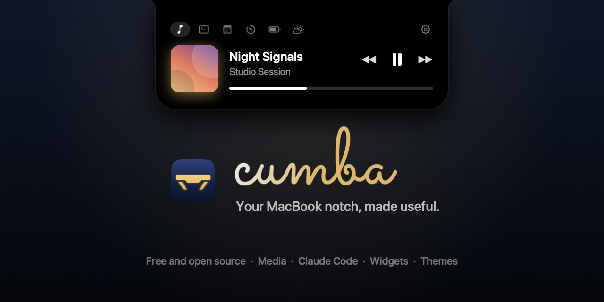
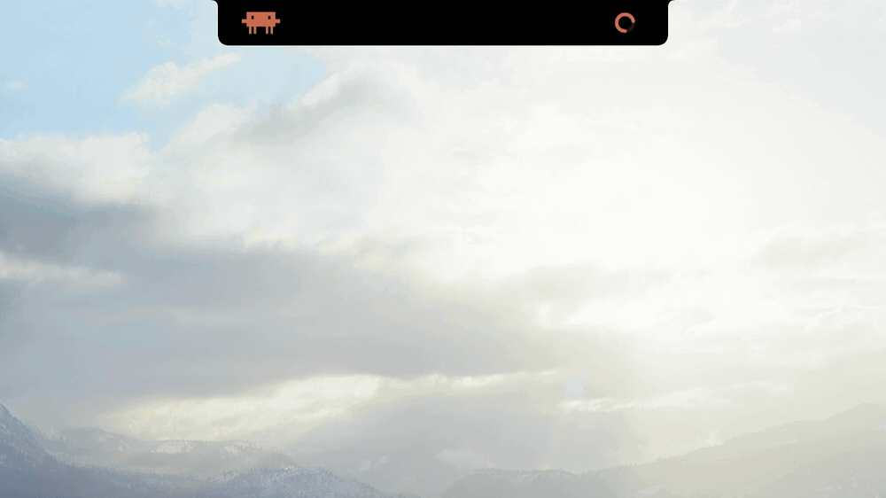

<p align="center"></p>

<h1 align="center">
  <picture>
    <source media="(prefers-color-scheme: dark)" srcset="docs/cumba-dark.svg">
    
  </picture>
</h1>

<p align="center"><sub>by LJASP · eski adıyla cumbaNotch</sub></p>

<p align="center">
  <a href="https://github.com/LJASP-studio/Cumba/releases/latest"></a>
  <a href="https://github.com/LJASP-studio/Cumba/actions/workflows/build.yml"></a>
  
  <a href="LICENSE"></a>
</p>

<p align="center"><a href="https://cumbanotch.com">cumbanotch.com</a> · <a href="README.md">English</a></p>

<p align="center"></p>

Cumba, macOS için ücretsiz ve açık kaynaklı bir notch uygulaması. İmleci MacBook'un notch'una getirdiğinizde altında bir panel açılır: çalan müzik ya da video, Claude Code ve Codex'in ne yaptığı ve seçtiğiniz widget'lar.

*Cumba*, eski Türk evlerinin üst katından sokağa taşan küçük çıkmadır: oturup sokağı seyrettiğiniz sakin bir köşe. Panel de aynısını ekranınızın tepesinden yapar.

## Neler var

- Hangi uygulamada ne çalıyorsa tek bir mini oynatıcıda: Spotify, Müzik, Safari ya da Chrome'da YouTube, podcast'ler. Kapak görseli, sarma ve kontroller; kurulacak bir şey yok.
- Notch'ta Claude Code ve Codex. Ajanın ne yaptığını görür, izin isteklerini İzin Ver, Reddet ya da Terminalde ile bulunduğunuz pencereden ayrılmadan yanıtlarsınız. Claude Code'da bağlam penceresinin ne kadar dolduğunu da görürsünüz.
- Sekmelerde widget'lar: görüşmeler için Katıl düğmeli takvim, Notlar, Anımsatıcılar, pano geçmişi, zamanlayıcı ve Pomodoro, hava durumu, AirDrop destekli dosya rafı ve daha fazlası.
- Düz siyah ve Liquid Glass'tan Neon Tokyo ve Synthwave'e sekiz tema. Cam, renk geçişi, neon kenar, renkler ve fontlarla kendi temanızı da yapıp JSON olarak paylaşabilirsiniz.
- Kapalı notch'un iki yanında canlı etkinlikler: işleyen zamanlayıcı, çalışan bir ajan, şarj, çalan şarkı, ses ve parlaklık.
- Tıklamalar menü çubuğuna geçer; Cumba tam ekran uygulamalarda da çalışır ve boştayken neredeyse hiç işlemci kullanmaz.
- Türkçe, İngilizce, İspanyolca ve Fransızca.

Notch'ta ne görüneceğine siz karar verirsiniz: hangi widget'lar, hangi sekmelerde, hangi sırayla, hangi temayla. Bir ajana notch'tan neye izin verilebileceğini de siz seçersiniz. Varsayılan ayarda kabuk komutları dışındaki her şeye izin verilebilir; bunu genişletebilir ya da İzin Ver'i kapatabilirsiniz. Sistemin ses göstergesi yerine notch'u kullanmak gibi ekstralar siz açana kadar kapalı kalır, Cumba da macOS izinlerini yalnızca onları gerektiren bir özelliği açtığınızda ister.

Tüm widget'lar ve seçenekler [Özellikler](docs/features.tr.md) sayfasında.

## İndirme ve kurulum

[Homebrew](https://brew.sh) ile kurun:

```bash
brew install --cask ljasp-studio/cumba/cumba
```

Ya da `.dmg` dosyasını [cumbanotch.com](https://cumbanotch.com)'dan veya [son sürümden](https://github.com/LJASP-studio/Cumba/releases/latest) indirip Cumba'yı Uygulamalar klasörüne sürükleyin. macOS 26 veya üstü gerekir. Notch'u olmayan Mac'ler sanal bir notch gösterebilir.

<a name="macos-neden-uyariyor"></a>

Cumba Apple tarafından notarize edilmedi, çünkü bu ücretli bir geliştirici hesabı gerektiriyor. Bu yüzden macOS indirilen kopyanın ilk açılışını engeller. Bir kez açmayı deneyin, ardından **Sistem Ayarları > Gizlilik ve Güvenlik**'te **Yine de Aç**'a tıklayın. Homebrew ile kurarsanız dosya doğrulanır ve bu adım gerekmez. [Uyarının anlamı](docs/safety.tr.md#macos-neden-uyariyor)

Cumba'nın simgesi menü çubuğunda durur. Notch'un arkasında kalırsa Ayarlar için notch'a sağ tıklayın.

<a name="kaynaktan-derleme"></a>
<a name="kaldırma"></a>

Dosyayı doğrulama, güncellemeler, cumbaNotch'tan geçiş, kaynaktan derleme ve kaldırma [Kurulum, güncelleme ve kaldırma](docs/install.tr.md) sayfasında.

<a name="guvenli-mi"></a>

## Güvenli mi?

Cumba yeni bir uygulama (ilk sürüm Ekim 2026). Tek bir geliştiricisi var ve kodunun büyük kısmı Claude Code ile yazılıyor. Henüz bağımsız bir güvenlik denetiminden de geçmedi. Yine de kimsenin sözüne güvenmeniz gerekmiyor. Uygulamanın tamamı bu depoda açık kaynak, her değişiklik `main`'e girmeden önce CI'dan geçmek zorunda ve sürümleri GitHub, etiketli commit'lerden derliyor. Dosyalar, doğrulayabileceğiniz imzalı bir derleme kaydı taşıyor.

[Cumba güvenli mi?](docs/safety.tr.md) macOS uyarısını açıklıyor ve bunların hepsini kendiniz doğrulamanız için komutları veriyor. Cumba'nın Mac'inizde nelere erişebildiği [Gizlilik ve izinler](docs/privacy.tr.md) sayfasında. Bir sorunu gizli olarak bildirmek için [SECURITY.md](SECURITY.md) dosyasına bakın.

## Gizlilik

Cumba telemetri göndermez. İnternete çıkan özellikler yalnızca bunlar:

| Özellik | Bağlandığı yer |
|---|---|
| Medya oynatıcıda Spotify kapakları | `i.scdn.co` |
| Medya oynatıcıda YouTube küçük resimleri | `*.ytimg.com`, `*.googleusercontent.com`, `*.ggpht.com` |
| Hava durumu, widget ekrandayken | Yaklaşık 10 km'ye yuvarlanmış konumunuzla (ya da seçtiğiniz şehirle) `api.open-meteo.com`, şehir araması için `geocoding-api.open-meteo.com`, şehir adı için Apple Haritalar |
| Güncelleme denetimi | Açılışta ve günde bir kez `api.github.com`; Ayarlar > Genel'den kapatabilirsiniz |

Her isteğin içinde ne olduğu [Gizlilik ve izinler](docs/privacy.tr.md) sayfasında.

## Destek

Cumba ücretsiz. İşinize yarıyorsa [GitHub Sponsors](https://github.com/sponsors/muazfurkan) ya da [Buy Me a Coffee](https://buymeacoffee.com/ljasp) üzerinden destek olabilirsiniz.

## Katkı

Sorular ve fikirler için [Discussions](https://github.com/LJASP-studio/Cumba/discussions) bölümünü kullanabilirsiniz. Kod katkısı yapmak isterseniz lütfen [CONTRIBUTING.md](CONTRIBUTING.md) ve [Davranış Kuralları](CODE_OF_CONDUCT.md) belgelerini okuyun. Güvenlik açıklarını [SECURITY.md](SECURITY.md) dosyasında anlatıldığı gibi gizli olarak bildirin.

## Lisans

[MIT](LICENSE)
